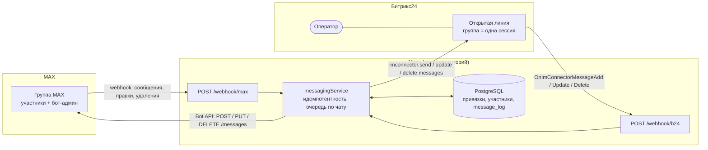

# MAX ↔ Битрикс24: коннектор для групповых чатов

> Двусторонний мост между групповыми чатами мессенджера **MAX** (`dev.max.ru`) и **Открытыми линиями Битрикс24**.

Штатный MAX-коннектор Битрикс24 не умеет работать с групповыми чатами. Этот коннектор закрывает пробел: один MAX-чат → одна сессия Open Lines, каждый участник группы опознаётся как отдельный отправитель внутри одной сессии. Сообщения ходят в обе стороны с автоматической подписью оператора при ответах в группу.

Single-tenant: один портал Б24 и один бот MAX на установку.

## Как это работает



Бот MAX — администратор группы: только так он получает все её сообщения. Первое сообщение из новой группы само создаёт привязку «группа ↔ чат Открытой линии», настраивать группы вручную не нужно.

## Возможности

- **Входящие** — приём webhook'ов MAX Bot API о событиях в подключённых группах, идентификация каждого автора внутри одной сессии Open Lines (`imconnector.register(CHAT_GROUP=true)`). Только группы: личка с ботом не открывает сессию ОЛ (автор получает одну подсказку «работаю только в группах»), посты каналов пропускаются.
- **Исходящие** — обработка `OnImConnectorMessageAdd` от Б24, отправка ответа оператора обратно в MAX-группу с автоматической подписью (`NEED_SIGNATURE=true`).
- **Очередь исходящих и безопасная остановка** — отправка, правка и удаление одного чата, уже пришедшие в мост, идут в MAX строго по очереди: удаление и правка, пришедшие, пока мост заливает файл в MAX, ждут конца заливки (событие о файле Б24 присылает только после его полной загрузки в Битрикс24, поэтому текст, отправленный во время такой загрузки, придёт раньше файла). Ответ Б24 — после доставки. При деплое и `docker stop` мост не закрывает порт, пока не закончит передачи (до 170 с; `stop_grace_period` 180 с); передачу, всё же прерванную рестартом, оператор видит системным сообщением в ОЛ «мост перезапускался».
- **Передача файлов** — фото, видео, документы и стикеры ходят в обе стороны; входящие голосовые (audio → `.ogg`, встроенный аудио-плеер в Open Lines) — MAX → Open Lines. Inbound — через `message.files` (Б24 качает по url сам); outbound — через MAX upload-флоу потоком через диск, по файлу за раз, с лимитом `MEDIA_MAX_BYTES` (256 МиБ); недоставленный файл оператор видит системным сообщением в ОЛ. Картинку, которую MAX не принимает как изображение (SVG, HEIC, сторона больше 7680 px, отказ MAX при заливке), мост отправляет файлом.
- **Reply/цитирование** — двусторонний мост «ответ на сообщение». MAX→OL: ответ участника превращается в визуальную `>>`-цитату в тексте OL (без БД и REST). OL→MAX: reply оператора становится нативным кликабельным reply в MAX (добор `REPLY_ID` через `im.dialog.messages.search`, отключаемо). Best-effort: сбой не валит доставку.
- **Редактирование сообщений** — двусторонний мост правки текста. MAX→OL: `message_edited` (тот же `mid`) обновляет сообщение в OL через `imconnector.update.messages` + маркер `Изменено`. OL→MAX: `OnImConnectorMessageUpdate` правит сообщение в MAX через `PUT /messages` (MAX сам ставит «Ред.»); правку, которая не дошла до MAX, оператор видит системным сообщением в ОЛ. Идемпотентность по синтетическому ключу без миграции БД (MAX→OL `edit:<mid>:<ts>`; OL→MAX `edit:<b24MsgId>:<хеш текста>` — в `OnImConnectorMessageUpdate` нет `message.date`); эхо-защита Б24 исключает петли. Правка медиа — вне скоупа.
- **Удаление сообщений** — двусторонний мост удаления. MAX→OL: `message_removed` (тот же `mid`) удаляет сообщение в OL через `imconnector.delete.messages` (с ретраями). OL→MAX: `OnImConnectorMessageDelete` удаляет сообщение в MAX через `DELETE /messages`; если удалить не вышло (сбой MAX, отказ MAX — `max-window`, удалено не всё), оператор видит системное сообщение в ОЛ. Идемпотентность по синтетическому ключу `delete:<id>` без миграции БД; эхо-защита by design на обеих платформах исключает петли. Работает и для медиа (удаление по внешнему id).
- **Название и иконка группы в чате ОЛ** — новый чат Open Lines получает название и иконку MAX-группы, а не имя и фото первого автора. Первым в чат пишет служебный пользователь «группа» (Б24 делает его фото аватаром чата), точное название ставит `imconnector.chat.name.set`. Переименование группы в MAX (`chat_title_changed`) доходит до ОЛ; при закрытой сессии — на следующем сообщении. Ссылку на группу в MAX оператор получает системным сообщением в чате ОЛ — группы клиентов приватные, по названию их не найти: новой группе — сразу после интро, подключённой раньше — один раз на следующем сообщении, повтор — только если MAX перевыпустил ссылку.
- **Группа — «Клиент» каждой сессии ОЛ** — в журнале диалогов и в контакт-центре видна группа, а не случайный участник. После закрытия диалога (`OnImConnectorDialogFinish`) следующую сессию открывает служебное «Новое обращение из группы «…» в MAX» от той же «группы». Если событие закрытия потеряно, а группу переименовали при закрытом диалоге, опенер всё равно уйдёт: закрытие мост узнаёт по ответу `CHAT_RENAMING_FAILED` на переименование чата ОЛ и проверяет через `imopenlines.dialog.get`.
- **Уведомления о составе группы** — при вступлении/выходе участника (`user_added`/`user_removed`) оператору в OL-чате показывается системное сообщение (`im.message.add`, `SYSTEM='Y'`); сессию не открывает, клиентам в MAX не уходит. Best-effort, не валит вебхук.
- **CRM-привязка** — выполняется оператором вручную в нативном UI Открытых линий; коннектор её не автоматизирует.
- **Идемпотентность** — дубли входящих (по `body.mid` MAX) и исходящих (по message id Б24) не создают повторных записей; журнал в `message_log`. Повтор исходящего события, пока первое ещё выполняется, отсекает строка задания `job:`.
- **Health-check** — runtime-проверка admin-прав бота в группе (`read_all_messages`) с предупреждением в чат.
- **Безопасность webhook'ов** — `X-Max-Bot-Api-Secret` для MAX, `application_token` для событий Б24.
- **Удаление приложения Б24** — `ONAPPUNINSTALL` сбрасывает токены портала, при `CLEAN=1` удаляет привязки, участников и журнал; до переустановки `/webhook/b24` отвечает `503 B24_APP_UNINSTALLED`, новые группы не подключаются.

## Технологический стек

| Слой | Технология |
|------|-----------|
| Backend | Node.js 24 (ESM) + Express 5 |
| База данных | PostgreSQL (`pg`) |
| Проверка входящих | plain-secret `X-Max-Bot-Api-Secret` (MAX), `application_token` + `member_id` (Б24), install-callback — обмен `refresh_token` |
| Внешние API | MAX Bot API, Bitrix24 REST (`imconnector.*`, `imopenlines.*`, `im.*`, OAuth) |
| Контейнеризация | Docker + Docker Compose |

Backend организован по паттерну **Structured Modules (Vertical Slices by Entity)** — адаптеры `max/` и `b24/` общаются только через координатор `messaging/`, где сосредоточены идемпотентность и audit-лог. Обзор слоёв и модулей — в [docs/backend/architecture.md](docs/backend/architecture.md).

## Быстрый старт с нуля

Шаги ниже поднимают мост в dev-режиме (nodemon, код смонтирован в контейнер) — так проще всего попробовать. Боевой режим за общим Caddy с Let's Encrypt, деплой и бэкапы — [docs/deploy/vps-prod.md](docs/deploy/vps-prod.md).

### 0. Что понадобится

- **Портал Битрикс24** с правами администратора: нужны локальное приложение и Контакт-центр. REST API Б24 работает только на коммерческих тарифах.
- **Бот MAX** и его токен (шаг 1).
- **Сервер с Docker** (плагин `docker compose`) и **домен с валидным HTTPS на порту 443**: MAX шлёт webhook только туда; сертификат — от доверенного центра (Let's Encrypt подходит) с полной цепочкой, самоподписанные не принимаются. Для разработки — любой HTTPS-туннель с валидным сертификатом до `127.0.0.1:8000`. Хост лучше держать в РФ: из-за рубежа порталы Б24 отвечают нестабильно ([почему](docs/deploy/vps-prod.md#2-доступ-к-vps)).
- Node.js 24 и pnpm 9 — только для тестов и запуска скриптов на хосте; сам мост работает в Docker.

### 1. Бот MAX

Боты MAX создаются на [платформе MAX для партнёров](https://business.max.ru/self) (сверено с dev.max.ru 2026-10-22):

1. Зарегистрируйтесь и пройдите верификацию профиля — она доступна юрлицам, ИП и самозанятым, резидентам РФ ([подключение](https://dev.max.ru/docs/maxbusiness/connection)). Без верифицированного профиля бота не создать.
2. **Чат-боты → Создать**: логотип, название, описание ([создание бота](https://dev.max.ru/docs/chatbots/bots-create/create)). Бот уходит на модерацию — до 48 часов по рабочим дням.
3. После модерации: **Чат-боты → бот → ⋮ → Настройки** — скопируйте «Токен доступа» ([управление ботом](https://dev.max.ru/docs/chatbots/bots-create/manage)). Там же, в разделе **«Приватность»**, разрешите добавлять бота в групповые чаты — по умолчанию это запрещено.
4. Придумайте секрет вебхука: `openssl rand -hex 32` (MAX принимает 5–256 символов из букв, цифр, `-` и `_`).

Бот пока не добавляйте в группу — это шаг 6.

### 2. Сервер и `.env`

```bash
git clone https://github.com/maxadrom/MAXTOB24.git
cd MAXTOB24
cp .env.example .env
```

Заполните в `.env` (полная таблица — [docs/backend/env.md](docs/backend/env.md)):

| Переменная | Значение |
|---|---|
| `MAX_BOT_TOKEN` | токен бота (шаг 1) |
| `MAX_WEBHOOK_SECRET` | секрет вебхука (шаг 1) |
| `MAX_PUBLIC_WEBHOOK_URL` | `https://<домен>/webhook/max` |
| `B24_PORTAL` | домен портала, например `your.bitrix24.ru` |
| `B24_EVENT_HANDLER_URL` | `https://<домен>/webhook/b24` |
| `B24_PLACEMENT_HANDLER_URL` | `https://<домен>/b24/connector-settings` |

`B24_CLIENT_ID`, `B24_CLIENT_SECRET` и `OL_LINE_ID` появятся на шагах 3–4. Поднимите стек и примените миграции:

```bash
COMPOSE_PROFILES=node,db-postgres docker compose up -d --build
docker compose --profile node exec api-node pnpm db:migrate
curl -s https://<домен>/health          # {"status":"healthy",...} — сервер доступен снаружи
```

`make dev-node` делает то же, но в foreground с логами в терминале — тогда остальные команды запускайте во втором. Порты `8000` и Postgres публикуются только на `127.0.0.1`; снаружи мост доступен через ваш reverse-proxy или туннель.

> `.env` попадает в контейнер только при его создании. После каждой правки `.env`: `docker compose --profile node up -d --force-recreate api-node` (`restart` его не перечитывает).

### 3. Приложение Битрикс24 («Только API»)

У моста нет интерфейса внутри Б24: токены портала приходят server-to-server на `POST /api/install`, когда вы сохраняете форму локального приложения.

1. На портале: **Разработчикам → Другое → Локальное приложение**. Отметьте «Приложение использует только API», путь для первоначальной установки — `https://<домен>/api/install`, права (scope):

   | Scope | Зачем |
   |---|---|
   | `imopenlines` | методы `imconnector.*` и `imopenlines.dialog.get` |
   | `imconnector` | события `OnImConnectorMessageAdd/Update/Delete` и `OnImConnectorDialogFinish` |
   | `im` | системные сообщения оператору (`im.message.add`), нативный reply (`im.dialog.messages.search`) |

2. **Сохраните** форму. Б24 покажет `client_id` и `client_secret` — впишите их в `.env` как `B24_CLIENT_ID` и `B24_CLIENT_SECRET` и пересоздайте `api-node` (команда выше).
3. **Сохраните форму ещё раз.** Первое сохранение мост отклонил (`503`, ключей ещё не было): подлинность установки он проверяет обменом `refresh_token` с этими ключами. После второго в логах `api-node` — `install verified: tokens saved`.

Подробности, коды ответов и переустановка — [docs/backend/app-installation.md](docs/backend/app-installation.md).

### 4. Открытая линия

1. В Контакт-центре создайте Открытую линию (или выберите существующую), куда пойдут сообщения групп.
2. Узнайте её числовой ID методом [`imopenlines.config.list.get`](https://apidocs.bitrix24.ru/api-reference/imopenlines/openlines/imopenlines-config-list-get.html) — например, через входящий вебхук портала (**Разработчикам → Другое → Входящий вебхук**, право `imopenlines`):
   ```bash
   curl -s 'https://<портал>/rest/<user_id>/<код вебхука>/imopenlines.config.list.get' | jq '.result[] | {ID, LINE_NAME}'
   ```
3. Впишите ID в `.env` как `OL_LINE_ID` и пересоздайте `api-node`. Вебхук после этого можно удалить: мост работает на токенах приложения.

### 5. Регистрация коннектора, вебхука MAX и событий Б24

```bash
make register-connector   # коннектор «Макс для групп» и его активация на линии OL_LINE_ID
make register-webhook     # подписка MAX на MAX_PUBLIC_WEBHOOK_URL с секретом
make register-events      # event.bind: сообщения, правки, удаления, закрытие диалога, удаление приложения
```

Каждый скрипт идемпотентен; `ARGS="--list"` показывает текущее состояние, `ARGS="--unregister"` — откат. Runbook'и: [Connector Registration](docs/backend/connector-registration.md), [MAX Webhook Setup](docs/backend/max-webhook-setup.md).

> ⚠️ `register-*` перенаправляют вебхуки MAX и Б24 на URL из текущего `.env`. Если тот же бот или портал уже обслуживает другой стенд (например, прод), запуск с dev-окружения уведёт его вебхуки.

### 6. Бот в группу

В приложении MAX откройте группу → **Участники → Добавить участников** → найдите бота. Затем назначьте его **администратором** с правами не меньше `read_all_messages` и `write`: без `read_all_messages` MAX не присылает боту события группы, без `write` бот не ответит ([подготовка бота](https://dev.max.ru/docs/chatbots/bots-coding/prepare)). Первого бота-администратора MAX позволяет назначить только вручную в мессенджере.

Если прав не хватает, бот один раз напишет об этом в группу ([Admin Health-check](docs/backend/admin-healthcheck.md)). Мост работает только в группах: личка с ботом и каналы не подключаются.

### 7. Проверка

- Напишите в группу — в Открытой линии появится чат с названием группы, сообщение — от имени автора.
- Ответьте оператором — ответ придёт в группу MAX с подписью оператора.
- В логах (`docker logs api`) — `delivered to Open Line` и `delivered to MAX`.

## Troubleshooting

| Симптом | Причина | Что делать |
|---|---|---|
| `curl https://<домен>/health` не отвечает или ругается на сертификат | домен не указывает на сервер, нет TLS или proxy не ведёт на `127.0.0.1:8000` | проверить DNS, сертификат и reverse-proxy (пример Caddy — [vps-prod.md §6](docs/deploy/vps-prod.md#6-caddy-site-блок--tls)) |
| `/api/install` → `503 CONFIG_ERROR`, токенов в БД нет | форму сохранили до того, как ключи попали в `.env`, или ключи неверные | вписать `B24_CLIENT_ID/SECRET`, пересоздать `api-node`, **пересохранить форму** — Б24 событие не повторяет |
| `/api/install` → `401 UNAUTHORIZED` | чужой портал (`B24_PORTAL`) или повтор уже потраченного `refresh_token` | проверить `B24_PORTAL`, пересохранить форму ([коды ответов](docs/backend/app-installation.md#ответы)) |
| `/webhook/max` → `401 SECRET_INVALID` / `SECRET_MISSING` | `MAX_WEBHOOK_SECRET` в `.env` не тот, с которым создана подписка | `make register-webhook ARGS="--unregister"`, поправить `.env`, пересоздать `api-node`, `make register-webhook` |
| `/webhook/max` → `503 WEBHOOK_NOT_CONFIGURED` | `MAX_WEBHOOK_SECRET` пуст | заполнить и пересоздать `api-node` |
| `/webhook/b24` → `401 B24_AUTH_INVALID` | событие не от нашего приложения или токен установки не сохранён | проверить установку (шаг 3) и `make register-events ARGS="--list"` |
| `/webhook/b24` → `503 B24_APP_UNINSTALLED` | приложение удалили на портале | переустановить ([переустановка](docs/backend/app-installation.md#переустановка)) |
| Сообщения из группы не доходят до ОЛ | у бота нет `read_all_messages` (не админ), это личка или канал, нет подписки MAX | права админа (шаг 6); `make register-webhook ARGS="--list"`; логи `api-node` |
| Бота не добавить в группу | добавление в группы запрещено настройками бота | платформа для партнёров: бот → ⋮ → Настройки → «Приватность» (шаг 1) |
| Ответ оператора не уходит в MAX | нет `event.bind` на `/webhook/b24` или нет scope `imconnector` | `make register-events ARGS="--list"`; scope приложения (шаг 3) |
| Правка `.env` не подействовала | контейнер перезапущен, а не пересоздан | `docker compose --profile node up -d --force-recreate api-node` |
| Скрипт на хосте: `getaddrinfo ENOTFOUND database` | хост `database` резолвится только внутри compose-сети | задать `DATABASE_URL` с `localhost:<DB_PORT>` в env процесса ([env.md](docs/backend/env.md#где-задавать-значения)) |
| Запросы к MAX: `UNABLE_TO_GET_ISSUER_CERT_LOCALLY` | вне Docker нет корня Минцифры для `platform-api2.max.ru` | `NODE_EXTRA_CA_CERTS=backends/node/api/certs/russian_trusted_root_ca.pem` или `MAX_API_BASE_URL=https://botapi.max.ru` ([env.md](docs/backend/env.md)) |

## HTTP-роуты

| Метод / путь | Назначение | Auth |
|--------------|-----------|------|
| `POST /webhook/max` | Входящие Update от MAX Bot API | `X-Max-Bot-Api-Secret` |
| `POST /webhook/b24` | События Б24 (`OnImConnectorMessageAdd` и пр., `ONAPPUNINSTALL` — удаление приложения) | `application_token` + `member_id` |
| `POST /api/install` | Server-to-server install-callback Б24 (`ONAPPINSTALL`); строгий rate-limit | обмен `refresh_token` с `B24_CLIENT_ID/SECRET` |
| `GET /b24/connector-settings` | PLACEMENT_HANDLER для `imconnector.register` (заглушка настроек коннектора) | — |
| `GET /health` | Health-check (публичный, без auth — для мониторинга и Caddy-проб) | — |
| `GET /` | API-only заглушка корня (Caddy catch-all → api-node); JSON-массив строк | — |

> JWT-зоны нет: роутов стартера `POST /api/getToken` и JWT-only `GET /api/health` больше нет, `JWT_*` не читаются. Вебхуки и `/api/install` защищены rate-limit.

## Операционные скрипты

Регистрационные/диагностические one-time скрипты (`make <target>` — внутри контейнера; `pnpm <script>` — из `backends/node/api/` на хосте):

| Скрипт | Назначение |
|--------|-----------|
| `register-connector` | Регистрация коннектора MAX в Б24 и активация на линии |
| `register-webhook` | Подписка MAX webhook'а |
| `register-events` | Привязка событий Б24: сообщения, правка, удаление, закрытие диалога, удаление приложения `OnAppUninstall` |
| `audit-bindings` | Read-only аудит привязок: тип каждого MAX-чата (`GET /chats/{id}`), лички и каналы среди привязок |
| `probe-imconnector-send`, `probe-max-send` | Проба отправки на живом портале и в живую группу |
| `probe-max-upload` | Проба 3-шагового upload-флоу MAX (медиа) |
| `probe-media-memory` | Замер RSS потока медиа (`downloadFile` → диск → `uploadBinary`) через loopback, без сети и `.env` — сравнение рантаймов Node |

> Скрипт, запущенный на хосте (`pnpm <script>` из `backends/node/api/`), сам читает корневой `.env` — без `export`. `DATABASE_URL` с хостом `database` с хоста не резолвится: задайте его в env процесса ([Environment](docs/backend/env.md#где-задавать-значения)).

## Документация

**Основы backend**

| Документ | Описание |
|----------|----------|
| [Architecture](docs/backend/architecture.md) | Слои/модули backend, как добавить модуль за 5 шагов |
| [Migrations](docs/backend/migrations.md) | SQL-runner, имена миграций, порядок на проде (только расширяющие, advisory lock), запуск на хосте, тестовая БД |
| [Environment](docs/backend/env.md) | Полная таблица env-переменных, коллизия `PORT` → `API_PORT`, корневой `.env` на хосте |
| [Logging](docs/backend/logging.md) | Формат pino, `requestId`, redact-список |
| [Webhooks](docs/backend/webhooks.md) | Паттерн проверки webhook'ов и идемпотентность |

**Runbook'и**

| Документ | Что внутри |
|----------|------------|
| [App Installation](docs/backend/app-installation.md) | Install-callback `POST /api/install`: проверка подлинности, коды ответов, первая установка, негативные пробы; удаление (`ONAPPUNINSTALL`) и переустановка |
| [Connector Registration](docs/backend/connector-registration.md) | `register-connector.js`, prerequisites, права приложения, откат |
| [MAX Webhook Setup](docs/backend/max-webhook-setup.md) | `register-webhook.js`, `SECRET_MISSING/INVALID` |
| [Inbound Routing](docs/backend/inbound-routing.md) | MAX → Open Lines, авто-онбординг (атомарный), только группы, сообщение без mid, аудит привязок, skip-вердикты `routeInbound` |
| [Outbound Routing](docs/backend/outbound-routing.md) | Open Lines → MAX, skip-вердикты `routeOutbound`, оповещение оператора о неудаче (`notifyOperator`) |
| [Formatting + Delivery](docs/backend/formatting-delivery.md) | BB↔markdown, delivery-статус |
| [Admin Health-check](docs/backend/admin-healthcheck.md) | Проверка `read_all_messages`, dedup-guard |
| [Media Transfer](docs/backend/media-transfer.md) | Передача файлов в обе стороны + входящие голосовые, upload-флоу, retry, картинка файлом при отказе MAX |
| [Membership Notifications](docs/backend/group-membership-notifications.md) | Системные уведомления о вступлении/выходе участников (`im.message.add`, миграция 0007) |
| [Group Title & Icon](docs/backend/group-title-icon.md) | Название и иконка MAX-группы в чате ОЛ: интро от «группы», `imconnector.chat.name.set`, `chat_title_changed`, миграция 0010; ссылка на группу системным сообщением, `CHAT_RENAMING_FAILED` → флаг опенера |
| [Group Session Opener](docs/backend/group-session-opener.md) | «Группа» — клиент каждой сессии ОЛ: `OnImConnectorDialogFinish`, опенер перед следующим входящим, миграция 0011; второй сигнал закрытия — `CHAT_RENAMING_FAILED` при переименовании группы |
| [Reply / Quoting](docs/backend/reply-quoting.md) | Двусторонний мост «ответ»: `>>`-цитата MAX→OL, нативный reply OL→MAX (`im.dialog.messages.search`) |
| [Message Editing](docs/backend/message-editing.md) | Двусторонний мост правки текста: `imconnector.update.messages` (MAX→OL) + `PUT /messages` (OL→MAX), маркер «Изменено», оповещение оператора о сбое |
| [Message Deletion](docs/backend/message-deletion.md) | Двусторонний мост удаления: `imconnector.delete.messages` (MAX→OL) + `DELETE /messages` (OL→MAX), оповещение оператора о неудаче (`max-window`, не полностью) |
| [Outbound Queue](docs/backend/outbound-queue.md) | Очередь исходящих по чату (FIFO, лимит `OUTBOUND_QUEUE_MAX`, `duplicate-in-progress`), строки `job:` в `message_log`, остановка с дренажом и открытым портом, оповещение о передачах, прерванных рестартом |
| [Deploy: VPS prod](docs/deploy/vps-prod.md) | Боевой VPS: Caddy + TLS, `make deploy`/`make pull-prod-env` (миграции до старта кода, догон `FROM`, `--delete` только по `backends/`, шаг `up` ждёт дренажа, health `/health`), рестарт и reboot, переезд на другой хост |

**Участие:** [CONTRIBUTING.md](CONTRIBUTING.md) — тесты, коммиты, правила архитектуры · [SECURITY.md](SECURITY.md) — как сообщить об уязвимости · контекст для AI-агентов — [AGENTS.md](AGENTS.md).

## Лицензия

MIT — см. [LICENSE](LICENSE).
